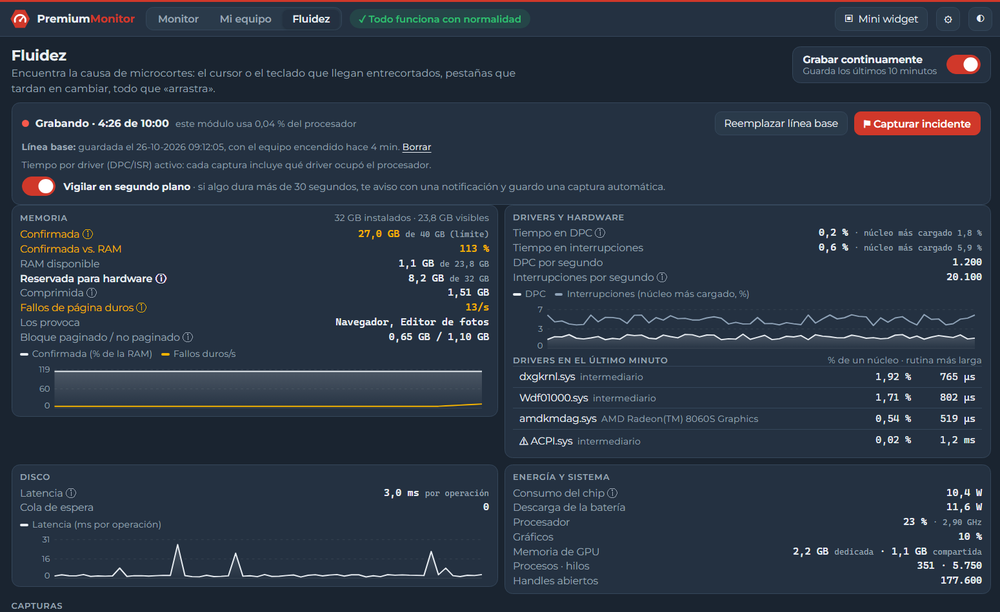
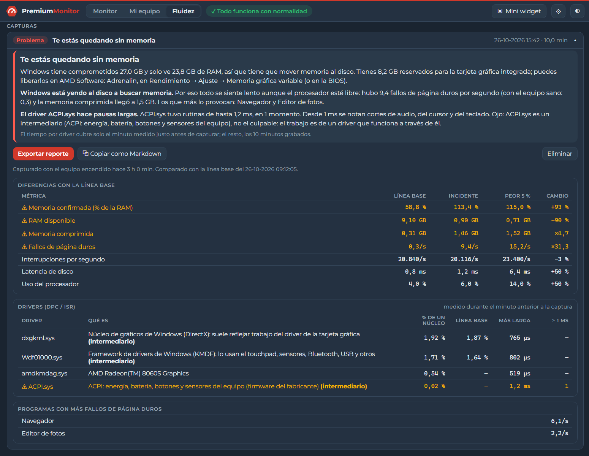
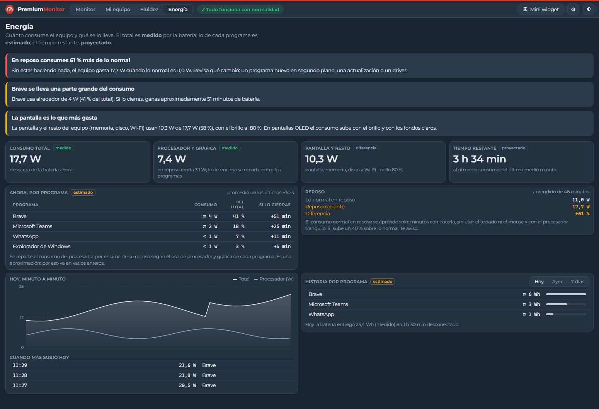

  

<h1 align="center">PremiumMonitor</h1>

  <b>Monitor de hardware para Windows, simple y en español.</b> 
  Lo útil de HWMonitor, CPU-Z, LatencyMon y WhySoSlow, sin cientos de sensores que nadie entiende.

  
  
  

  

## ⬇️ Descargar

Entra a la **[última versión](../../releases/latest)** y elige:

| Archivo | Para qué |
|---|---|
| `PremiumMonitor_x.y.z_x64-setup.exe` | **Instalador** (recomendado). No pide permisos de administrador e incluye los sensores avanzados. |
| `PremiumMonitor_x.y.z_portable.exe` | Versión **portable**, sin instalar. Todo funciona excepto los sensores avanzados. |
| `SHA256SUMS.txt` | Huellas para verificar que los archivos no fueron alterados. |

**Requisitos:** Windows 10 u 11 de 64 bits.

> [!NOTE]
> Esta versión todavía no está firmada digitalmente, así que Windows puede mostrar *"Windows protegió su PC"*. Para abrirla, haz clic en **Más información → Ejecutar de todas formas**.

## Qué hace

- **Resumen de un vistazo**: medidores de procesador, temperatura, memoria, gráficos y batería, más los programas que más consumen.
- **Vista detallada** de cada recurso, con gráfico, datos y qué programa lo está usando.
- **Batería en serio**: consumo en **vatios**, tiempo restante, **salud** y ciclos de carga.
- **Fluidez**: encuentra la causa de microcortes y tirones, incluido el driver culpable y, desde 0.3.0, **la pantalla**. **Reemplaza a LatencyMon y WhySoSlow**. Ver [más abajo](#fluidez-microcortes-y-tirones).
- **Energía** (nuevo en 0.3.0): cuánto consume cada programa, minutos de batería que ganas cerrándolo, historia de los últimos días y aviso si el equipo gasta más de lo normal en reposo. Ver [más abajo](#energía-qué-se-lleva-la-batería).
- **Memoria reservada para hardware** a la vista: por qué un equipo con 32 GB muestra 24 en Windows.
- **Avisos en lenguaje simple**: RAM casi llena, poco espacio, batería que se descarga rápido o equipo muy caliente.
- **Mi equipo**: especificaciones del PC y un botón para copiarlas y enviarlas a soporte.
- **Mini widget** siempre visible y acceso desde la **bandeja del sistema**.
- **Consumo mínimo**: menos del 0,5 % del procesador, y casi nada de memoria cuando está en la bandeja.

<table>
  <tr>
    <td width="50%"></td>
    <td width="50%"></td>
  </tr>
  <tr>
    <td></td>
    <td align="center"></td>
  </tr>
</table>

## Fluidez: microcortes y tirones

Cuando el cursor o el teclado llegan entrecortados y todo «arrastra», el Administrador de tareas suele mostrar el equipo sano. La pestaña **Fluidez** encuentra la causa sin tener que abrir LatencyMon ni otras herramientas:

- **Graba los últimos 10 minutos**, segundo a segundo, para que el problema no se haya ido cuando lo vas a revisar. Está apagada hasta que la activas y consume muy poco (alrededor del 0,05 % del procesador).
- **Capturar incidente** congela esos 10 minutos y te dice en palabras simples **qué pasa y qué hacer**: falta de memoria, Windows yendo al disco, un driver con pausas largas o un disco lento.
- **Línea base**: guarda cómo anda el equipo cuando está bien, para comparar cada captura con tu propio equipo.
- **Tiempo por driver**, como LatencyMon, con el nombre del dispositivo y un aviso cuando el driver solo es un intermediario.
- **Pantalla** (nuevo en 0.3.0): frecuencia, HDR, el rango de FreeSync de tu monitor y la antigüedad del driver de video. **Probar pantalla** mide en 5 segundos si el escritorio dibuja con fluidez; si dibuja por debajo del rango de tu pantalla, te dice qué cambiar. Es una causa de microcortes al escribir y mover el mouse que ninguna otra herramienta muestra.
- **Vigilar en segundo plano**: si algo dura más de 30 segundos, guarda una captura automática y te avisa.
- **Exportar reporte** para pegarlo en un chat o enviarlo a soporte.

<table>
  <tr>
    <td width="50%"></td>
    <td width="50%"></td>
  </tr>
</table>

El tiempo por driver necesita un permiso de administrador: **Capturar con drivers** lo pide una vez y mide durante un minuto. Todo lo demás funciona sin permisos. A diferencia de LatencyMon, no instala un driver propio, así que no mide su «latencia de interrupción a proceso».

## Energía: qué se lleva la batería

Windows ordena las apps por «Alto, Medio, Bajo», sin números. La pestaña **Energía** te da vatios y deja claro qué es medido y qué es estimado:

- **Consumo total** de la batería y del procesador, **medidos**. La diferencia es la **pantalla y el resto del equipo**, que suele ser lo que más gasta.
- **Consumo de cada programa**, **estimado** según su uso de procesador y gráfica, y **cuántos minutos de batería ganas** si lo cierras.
- **Historia**: qué gastó más hoy, ayer y en la semana, y qué estaba abierto cuando el consumo subió.
- **Aviso de reposo**: la app aprende cuánto gasta tu equipo sin hacer nada y te avisa si sube un 40 % o más, una señal temprana de que algo anda mal.

  

## Temperatura exacta del procesador (opcional)

Por defecto PremiumMonitor muestra la temperatura de la tarjeta gráfica y una temperatura **aproximada** del equipo, sin pedir permisos.

Para ver la temperatura **real** del procesador, activa los **sensores avanzados** desde la app. Con un único permiso de administrador, la app instala el driver [PawnIO](https://pawnio.eu), firmado y de código abierto, el mismo que usan LibreHardwareMonitor y FanControl. Si nunca activas esta opción, no se instala nada.

## Privacidad

Todo se mide en tu equipo. PremiumMonitor no envía datos a ningún servidor y no tiene telemetría.

## Soporte

¿Encontraste un problema o tienes una sugerencia? Abre un [issue](../../issues).

## Componentes de terceros

El instalador incluye, sin modificar:
- el instalador oficial de **PawnIO** 2.2.0 (GPL-2.0; [código fuente](https://github.com/namazso/PawnIO));
- los módulos **PawnIO.Modules** 0.2.11 (LGPL-2.1; [código fuente](https://github.com/namazso/PawnIO.Modules)).

Sus licencias se instalan junto a la app. La tipografía Montserrat se usa bajo licencia SIL Open Font License 1.1.

---

Desarrollada por José Antonio Dieguez con asistencia de Claude Opus 5.5 (Anthropic) · Herramienta provista por <a href="https://premiumhosting.cl">PremiumHosting.cl</a> © 2026 José Antonio Dieguez. Todos los derechos reservados, salvo los componentes de terceros indicados.

