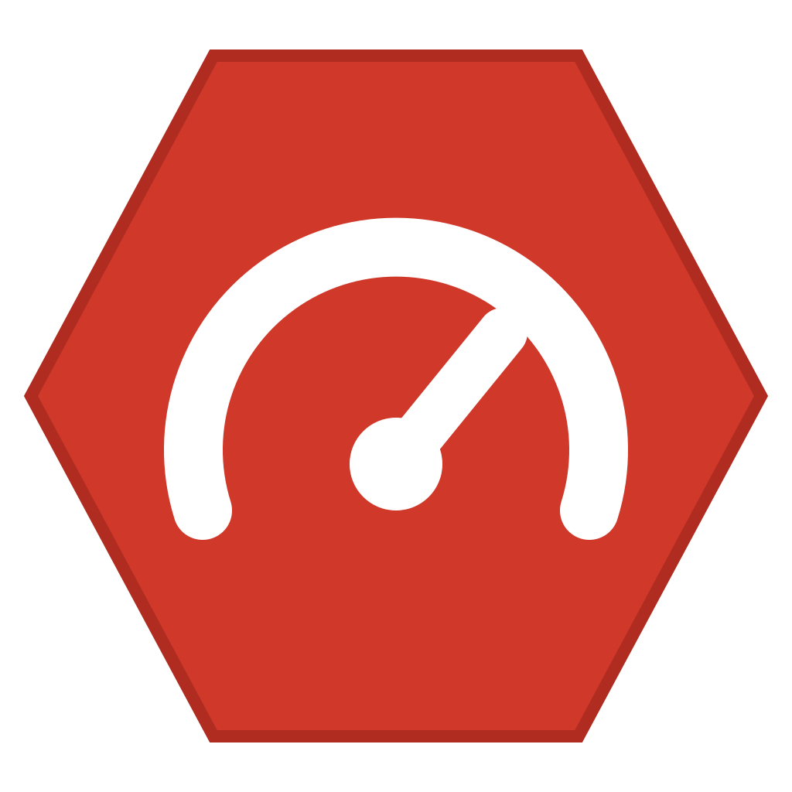
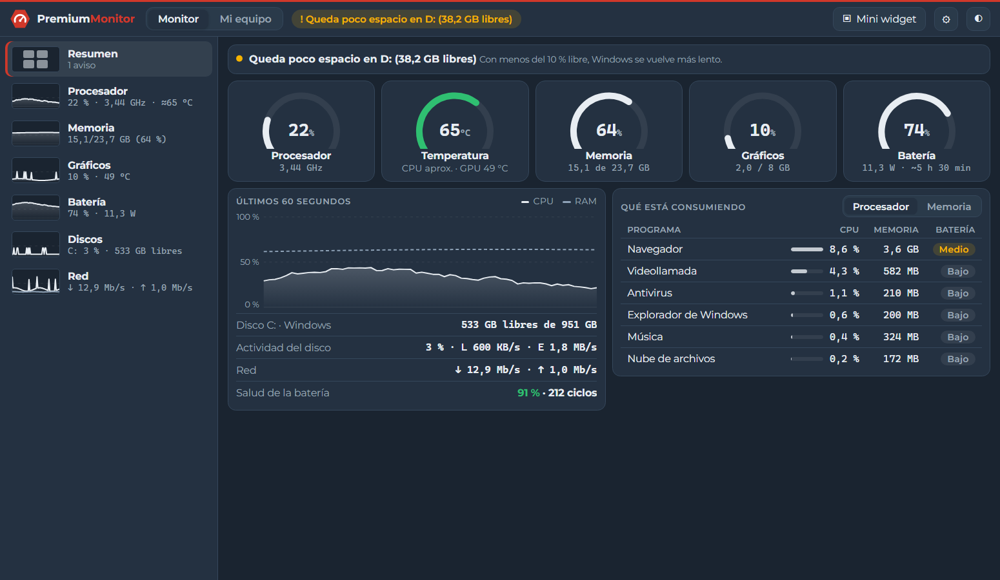
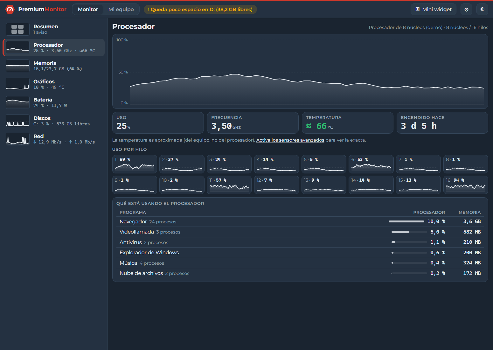
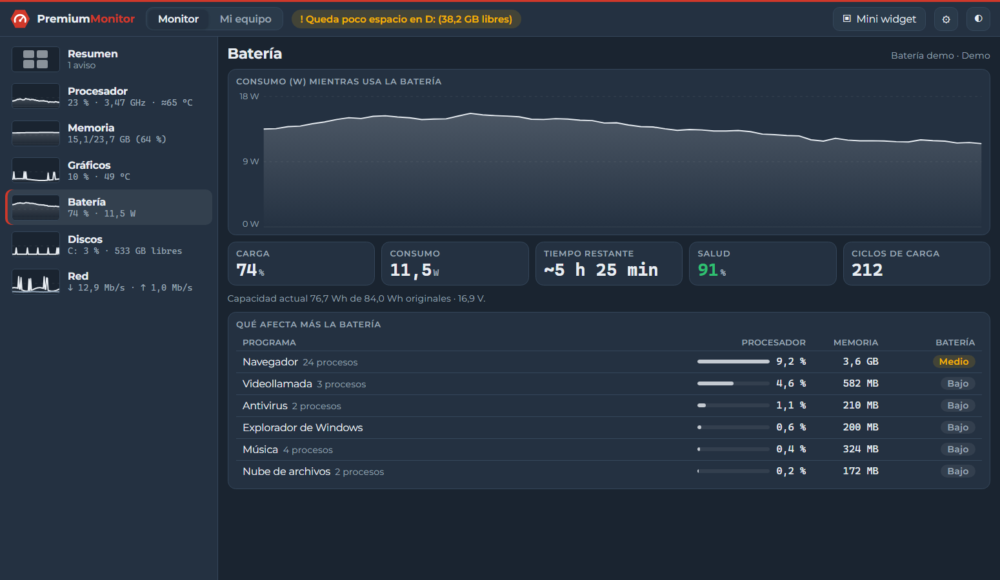
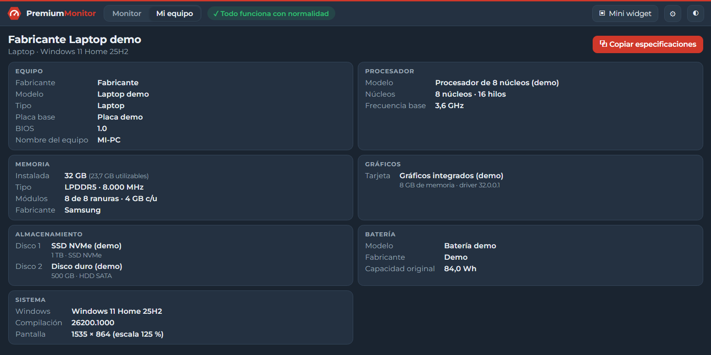
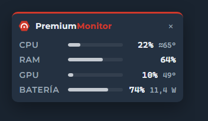

  

<h1 align="center">PremiumMonitor</h1>

  <b>Monitor de hardware para Windows, simple y en español.</b> 
  Lo útil de HWMonitor y CPU-Z, sin cientos de sensores que nadie entiende.

  
  
  

  

## ⬇️ Descargar

Entra a la **[última versión](../../releases/latest)** y elige:

| Archivo | Para qué |
|---|---|
| `PremiumMonitor_x.y.z_x64-setup.exe` | **Instalador** (recomendado). No pide permisos de administrador e incluye los sensores avanzados. |
| `PremiumMonitor_x.y.z_portable.exe` | Versión **portable**, sin instalar. Todo funciona excepto los sensores avanzados. |
| `SHA256SUMS.txt` | Huellas para verificar que los archivos no fueron alterados. |

**Requisitos:** Windows 10 u 11 de 64 bits.

> [!NOTE]
> Esta versión todavía no está firmada digitalmente, así que Windows puede mostrar *"Windows protegió su PC"*. Para abrirla, haz clic en **Más información → Ejecutar de todas formas**.

## Qué hace

- **Resumen de un vistazo**: medidores de procesador, temperatura, memoria, gráficos y batería, más los programas que más consumen.
- **Vista detallada** de cada recurso, con gráfico, datos y qué programa lo está usando.
- **Batería en serio**: consumo en **vatios**, tiempo restante, **salud** y ciclos de carga.
- **Avisos en lenguaje simple**: RAM casi llena, poco espacio, batería que se descarga rápido o equipo muy caliente.
- **Mi equipo**: especificaciones del PC y un botón para copiarlas y enviarlas a soporte.
- **Mini widget** siempre visible y acceso desde la **bandeja del sistema**.
- **Consumo mínimo**: menos del 0,5 % del procesador.

<table>
  <tr>
    <td width="50%"></td>
    <td width="50%"></td>
  </tr>
  <tr>
    <td></td>
    <td align="center"></td>
  </tr>
</table>

## Temperatura exacta del procesador (opcional)

Por defecto PremiumMonitor muestra la temperatura de la tarjeta gráfica y una temperatura **aproximada** del equipo, sin pedir permisos.

Para ver la temperatura **real** del procesador, activa los **sensores avanzados** desde la app. Con un único permiso de administrador, la app instala el driver [PawnIO](https://pawnio.eu), firmado y de código abierto, el mismo que usan LibreHardwareMonitor y FanControl. Si nunca activas esta opción, no se instala nada.

## Privacidad

Todo se mide en tu equipo. PremiumMonitor no envía datos a ningún servidor y no tiene telemetría.

## Soporte

¿Encontraste un problema o tienes una sugerencia? Abre un [issue](../../issues).

## Componentes de terceros

El instalador incluye, sin modificar:
- el instalador oficial de **PawnIO** 2.2.0 (GPL-2.0; [código fuente](https://github.com/namazso/PawnIO));
- los módulos **PawnIO.Modules** 0.2.11 (LGPL-2.1; [código fuente](https://github.com/namazso/PawnIO.Modules)).

Sus licencias se instalan junto a la app. La tipografía Montserrat se usa bajo licencia SIL Open Font License 1.1.

---

Desarrollada por José Antonio Dieguez con asistencia de Claude Opus 5.5 (Anthropic) · Herramienta provista por <a href="https://premiumhosting.cl">PremiumHosting.cl</a> © 2026 José Antonio Dieguez. Todos los derechos reservados, salvo los componentes de terceros indicados.

